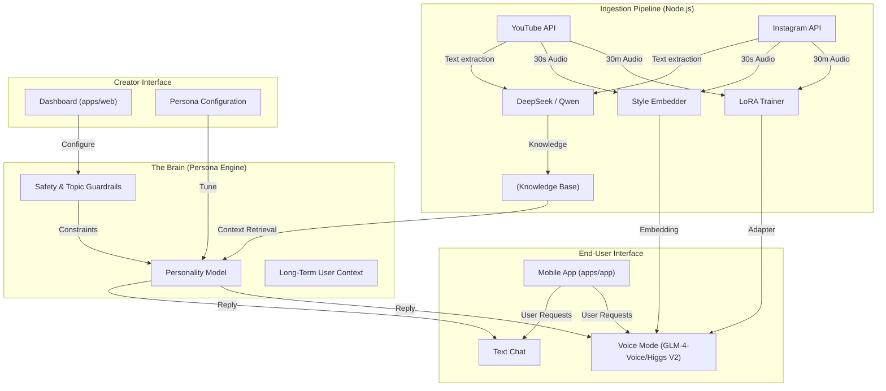

# Hear: The Zero-Friction Digital Twin Platform

> **Status**: Pre-Alpha ("Hollow" MVP)  
> **Architecture**: Monorepo (Turbo + pnpm)  
> **Key Tech**: Next.js 15, Fastify, DeepSeek, Higgs Audio V2, Demucs, Pyannote.

---

## 📚 Project Documentation
*   **[Executive Summary](docs/executive_summary.md)**: Product Vision & Pillars.
*   **[Implementation Plan](docs/implementation_plan.md)**: Detailed technical architecture & standardized ingestion.
*   **[App Architecture](docs/app_architecture.md)**: End-User App (apps/app) architecture, API contracts, and integration patterns.
*   **[Handover](docs/handover.md)**: Current status & immediate next steps.
*   **[Task List](docs/task.md)**: Roadmap progress.
*   **[Integration Guide](docs/integration_guide.md)**: Setup guides (e.g., GLM-4-Voice).
*   **[Production Strategy](docs/production_strategy.md)**: Deployment & Safety.
*   **[Hosting & Deployment](docs/deployment.md)**: Manual for AWS Lightsail, S3, and RunPod.

---

## 1. Vision: The Effortless Digital Twin
**Hear** is an AI platform that allows Creators to scale their intimacy without scaling their effort. Our core value proposition is **Zero-Friction Onboarding**: a creator drops a link to their YouTube or Instagram, and we instantly generate a high-fidelity "Digital Twin" that knows their stories, speaks in their style, and respects their boundaries.

## 2. Product Pillars
1.  **Creator-First Onboarding**:
    *   **Authorized Ingestion**: Securely connect **YouTube & Instagram** via OAuth.
        *   **Stage 1: Discovery**: We scan the repo to normalized "Content Items" (Videos, Posts).
        *   **Stage 2: Deep Parsing**:
            *   **Video/Audio**: For Tier 1 Voice. **Processed via Demucs (Noise Removal) & Pyannote (Diarization)** to ensure clean, isolated vocals.
            *   **Meta-Data**: Titles, Descriptions, Post Captions.
            *   **Social**: Comments (to learn how they reply to fans).
    *   **Fine-Tuning Studio**: Simple controls for "Topics to Avoid" (e.g., "Don't talk about my ex") and "Personality Sliders" (Sassy vs. Supportive).
2.  **Hybrid Engagement**:
    *   **Text Chat (Baseline)**: Always-available, low-cost intimacy for the massive fan base.
    *   **Voice-to-Voice (Premium)**: High-fidelity, emotional audio calls for super-fans, utilizing GLM-4-Voice for pseudo-duplex interaction.

## Architecture Overview

**Hear** is composed of four main applications:

| App | Path | Description | Tech Stack |
| :--- | :--- | :--- | :--- |
| **Creator Dashboard** | [`apps/web`](apps/web) | Portal for creators to onboard and manage their AI. | Next.js 15, Tailwind |
| **Consumer App** | [`apps/app`](apps/app) | Mobile-first PWA for fans to chat with AI personas. | Next.js 16, PWA |
| **Backend API** | [`apps/server`](apps/server) | Central API gateway and orchestration layer. | Fastify, Node.js |
| **AI Workers** | [`apps/worker-*`](apps/) | Semantic/Voice processing units (Higgs, Cleanser). | Python, RunPod |

## Documentation

*   **[Start Here: Documentation Index](docs/README.md)**
*   [Deployment Guide](docs/deployment.md)
*   [Consumer App Architecture](docs/app_architecture.md)

## Development

### Prerequisites
*   Node.js 20+ (managed via `volta` or `nvm`)
*   pnpm 9+
*   Python 3.10+ (for workers)
*   Docker (for deployment builds)

## 4. Workload & Roadmap

*   **Phase 1: The "Digital Twin" Factory (Tier 1 Focus)**
    *   🎯 **Goal**: Creator links YouTube -> We extract Text Personality + **Instant Voice Clone** (Embedding).
    *   🛠 **Tech**: DeepSeek (Brain), Higgs Audio V2 (Instant Voice), Supabase, **Python Worker**.
    *   ✅ **Status**: Audio clean-up/diarization mechanism implemented via `apps/worker` (Demucs + Pyannote).

* 3.  **Pipeline Flow (official APIs)**:
    1.  **Auth**: Creator logs in with Google/Meta.
    2.  **Fetch**: Server pulls captions/posts via official APIs.
    3.  **Process**: LangChain extracts structured Persona.
    4.  **Clone**: Bot is ready.

*   **Phase 2: Creator Studio**
    *   🎯 **Goal**: Creator Dashboard to tweak the brain.
    *   🛠 **UI**: "Rule Builder" interface, "Memory Viewer".

*   **Phase 3: The Voice Layer**
    *   🎯 **Goal**: Add audio support to the existing Persona.
    *   🛠 **Tech**: Voice Cloning (fine-tuned on the Ingested Audio).

## 5. Deployment & Hosting (Dev)

We use a cost-optimized hybrid stack:

### Backend (Server)
- **Host**: **AWS Lightsail Container Service** (Micro) in `ca-central-1`.
- **Why**: Stable URL, native WebSockets, fixed low cost (~$7/mo).
- **Proximity**: Colocated with Supabase DB (Canada).

### Frontend (Web & App)
- **Host**: **AWS S3 + CloudFront**.
- **Distribution**: Global Edge Caching via CloudFront.
- **Cost**: Pay-per-request (Extremely low).

### Compute (Workers)
- **Host**: **RunPod Serverless** (GPU).
- **Why**: Scale-to-zero GPU inference for Audio/LLM tasks.

## 6. CI/CD Workflows

- **`Deploy Server`**: Pushes directly to AWS Lightsail (Zero Downtime).
- **`Deploy Web & App`**: Builds static site, syncs to S3, invalidates CloudFront.
- **`Deploy Workers`**: Pushes Docker images to GHCR for RunPod.

## 7. Strategic Advantage
Our competitors focus on "Chatting." We focus on **"Cloning."** By making the training process automatic (ingesting existing content), we solve the #1 problem for creators: **Laziness/Time**. They don't want to write a prompt; they want to be uploaded.
