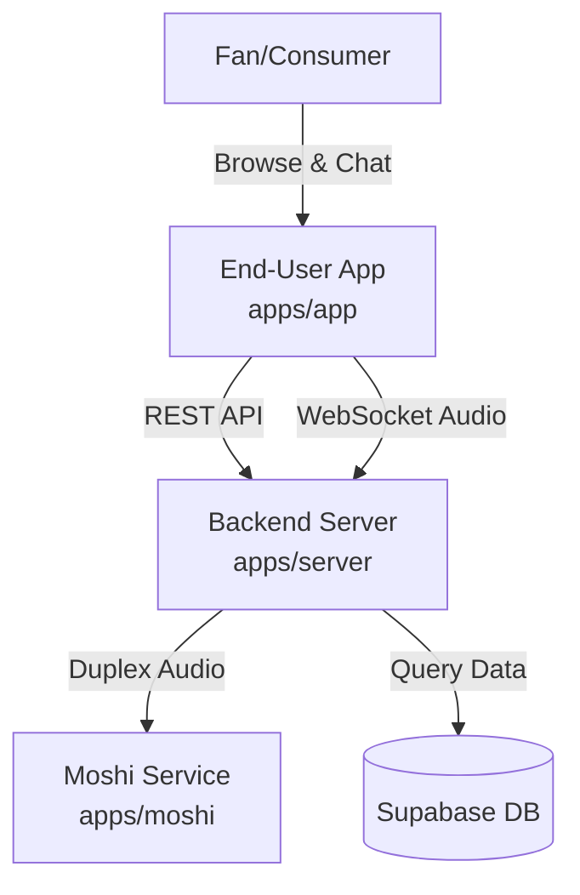

# End-User App Architecture

## Overview

The End-User App (`apps/app`) is the consumer-facing mobile-first PWA that enables fans to discover, follow, and interact with AI creator clones. This document outlines the architecture, user flows, and integration patterns.

## System Context



## User Journeys

### 1. Organic Discovery
```
User opens app → Browse catalog → Search/Filter → View creator profile → Start chat
```

### 2. Deep Link Entry (QR Code / Referral)
```
User scans QR → App opens at /c/creator-slug → View profile → Start chat → (Optional) Unlock premium features
```

### 3. Reference Code Entry
```
User opens app → Enter reference code → Unlock creator → Navigate to profile
```

## Core Features

### Authentication

**Routes**: `/login`

**SSO Providers**:
- Google OAuth 2.0
- Meta (Facebook) OAuth 2.0

**Implementation Strategy**:
```typescript
// Using Supabase Auth
import { createClient } from '@supabase/supabase-js'

const supabase = createClient(SUPABASE_URL, SUPABASE_KEY)

// Google Sign-In
await supabase.auth.signInWithOAuth({
  provider: 'google',
  options: {
    redirectTo: `${window.location.origin}/auth/callback`
  }
})

// Facebook Sign-In
await supabase.auth.signInWithOAuth({
  provider: 'facebook',
  options: {
    redirectTo: `${window.location.origin}/auth/callback`
  }
})
```

**Session Management**:
- JWT tokens stored in httpOnly cookies
- Automatic refresh on expiry
- Logout clears all local state

### Discovery & Catalog

**Route**: `/`

**Features**:
1. **Search Bar**: Real-time search across creator names, tags, categories
2. **Category Filters**: Trending, New, Gaming, Music, Tech, etc.
3. **Featured Carousel**: Highlighted creators (premium placement)
4. **Recent Chats**: Resume conversations with recent creators

**API Contract**:
```typescript
// GET /api/personas
{
  personas: [
    {
      id: string
      slug: string
      name: string
      avatar: string
      bio: string
      category: string
      followerCount: number
      rating: number
      isOnline: boolean
      voiceTier: 1 | 2  // Tier 1: Async, Tier 2: Duplex
    }
  ]
}

// GET /api/personas/search?q=gaming&category=trending
// Same response schema, filtered
```

### Creator Profile (Deep Linking)

**Route**: `/c/[slug]`

**URL Patterns**:
- Direct: `hear.app/c/creator-name`
- QR Code: Generates URL with tracking param `?ref=qr_campaign_id`
- Referral: `hear.app/c/creator-name?ref=user_referral_code`

**Profile Data**:
```typescript
// GET /api/personas/:slug
{
  id: string
  slug: string
  name: string
  username: string
  avatar: string
  coverImage: string
  bio: string
  stats: {
    followers: number
    rating: number
    totalMessages: number
  }
  voiceTier: 1 | 2
  tags: string[]
  isFollowing: boolean  // for current user
}
```

**Actions**:
- **Follow/Unfollow**: `POST /api/personas/:id/follow`
- **Start Chat**: Navigate to `/chat/:creatorId`
- **Start Call**: Navigate to `/chat/:creatorId?mode=voice`

### Chat Interface

**Route**: `/chat/[creatorId]`

**Modes**:
1. **Text Chat** (Default)
2. **Voice Tier 1** (Async Push-to-Talk)
3. **Voice Tier 2** (Live Duplex)

#### Mode 1: Text Chat

Standard message-based chat interface.

**API Contract**:
```typescript
// GET /api/chat/:creatorId/messages
{
  messages: [
    {
      id: string
      from: 'user' | 'creator'
      content: string
      timestamp: string
    }
  ]
}

// POST /api/chat/:creatorId/messages
{
  content: string
}
// Response: { message: Message }
```

**Real-time Updates**:
- WebSocket connection for live message delivery
- Typing indicators
- Read receipts

#### Mode 2: Voice Tier 1 (Async)

User records voice → Server processes → Response as audio bubble

**Flow**:
```
1. User taps Mic → Record audio (client-side)
2. Stop recording → Upload to server
3. POST /api/chat/:creatorId/voice-message
   Body: { audio: File }
4. Server:
   - STT (Whisper): Audio → Text
   - LLM (Brain): Text → Response Text
   - TTS (Higgs V2): Response Text → Audio
5. Response:
   {
     messageId: string
     text: string
     audioUrl: string  // Signed URL to audio file
   }
6. App displays bubble with playable audio
```

**UI State**:
- Recording (red pulsing mic)
- Uploading (spinner)
- Processing (waiting for response)
- Complete (audio bubble appears)

#### Mode 3: Voice Tier 2 (Live Duplex)

Full-duplex, Moshi-powered conversation.

**Flow**:
```
1. User taps Phone icon → Enter voice mode
2. Establish WebSocket connection: ws://server/ws/audio
3. Two-way streaming:
   - Client → Server: User audio (PCM chunks)
   - Server → Client: Creator audio (PCM chunks)
4. Server proxies to Moshi service (2-stream model)
5. Real-time playback in app
6. User taps End Call → Close WebSocket
```

**WebSocket Protocol**:
```typescript
// Client → Server
{
  type: 'audio_chunk'
  data: ArrayBuffer  // PCM audio
}

// Server → Client
{
  type: 'audio_chunk'
  data: ArrayBuffer  // PCM audio
}

// Control messages
{ type: 'start_call', creatorId: string }
{ type: 'end_call' }
{ type: 'error', message: string }
```

**UI State**:
- Full-screen overlay
- Animated avatar (pulse on speaking)
- Status: "Connecting...", "Listening...", "Speaking..."
- End Call button (red, bottom center)

## State Management

Using **Zustand** for client-side state:

```typescript
// stores/chatStore.ts
interface ChatStore {
  activeCreatorId: string | null
  mode: 'text' | 'voice_tier1' | 'voice_tier2'
  messages: Message[]
  isRecording: boolean
  audioStream: MediaStream | null
  
  setMode: (mode: ChatStore['mode']) => void
  startRecording: () => void
  stopRecording: () => void
  sendMessage: (content: string) => Promise<void>
}

// Usage
const { mode, setMode } = useChatStore()
```

## Deep Linking & QR Codes

### QR Code Generation (Creator Side)
Creators generate QR codes in the Creator Dashboard (`apps/web`):

```typescript
// apps/web: Generate QR for creator
const qrUrl = `https://hear.app/c/${creator.slug}?ref=${creator.campaignId}`
// QR code encodes this URL
```

### QR Code Handling (Consumer Side)
When scanned, the app:

1. Parses the URL
2. Extracts `slug` and `ref` param
3. Navigates to `/c/[slug]`
4. If `ref` is present:
   - Track attribution: `POST /api/referrals/track`
   - Potentially unlock premium features

### Reference Codes

Alternative to QR for manual entry:

```typescript
// User enters code: "CREATOR123"
POST /api/referrals/resolve
{
  code: "CREATOR123"
}

// Response:
{
  creatorId: string
  slug: string
  unlocked: boolean  // If code grants premium access
}

// Navigate to /c/:slug
```

## API Integration

### Base Configuration

```typescript
// lib/api.ts
const API_BASE = process.env.NEXT_PUBLIC_API_URL || 'http://localhost:8000'

export const api = {
  get: (path: string) => fetch(`${API_BASE}${path}`),
  post: (path: string, body: any) => fetch(`${API_BASE}${path}`, {
    method: 'POST',
    headers: { 'Content-Type': 'application/json' },
    body: JSON.stringify(body)
  })
}
```

### Authentication Headers

```typescript
// Attach JWT to all requests
const token = await supabase.auth.getSession()
headers: {
  'Authorization': `Bearer ${token.access_token}`
}
```

## Performance Considerations

### Image Optimization
- Use Next.js `<Image>` component
- Lazy load creator avatars in catalog
- Blur placeholder for better UX

### Route Prefetching
- Prefetch creator profiles on hover (desktop)
- Prefetch chat page when viewing profile

### Audio Optimization
- For Tier 1: Compress audio before upload (Opus)
- For Tier 2: Use WebRTC for lower latency
- Cache TTS responses for common phrases

## Security

### Input Validation
- Sanitize all user input before sending to API
- Prevent XSS in chat messages (escape HTML)

### Audio Permissions
- Request microphone permission only when needed
- Show clear permission prompt with explanation
- Graceful degradation if denied

### Rate Limiting
- Client-side: Debounce search queries
- Server-side: Enforce rate limits per user (handled in `apps/server`)

## Progressive Web App (PWA)

### Future Enhancements
1. **Service Worker**: Cache chat history for offline viewing
2. **Manifest**: Add to home screen for native feel
3. **Push Notifications**: Notify users of new messages
4. **Background Sync**: Queue messages when offline

## Deployment

### Environment Variables
```env
# API Configuration
NEXT_PUBLIC_API_URL=http://localhost:8000
NEXT_PUBLIC_APP_URL=http://localhost:3000

# Supabase (Dev Environment)
# Run 'npx supabase start' to get these values
NEXT_PUBLIC_SUPABASE_URL=http://127.0.0.1:54321
NEXT_PUBLIC_SUPABASE_ANON_KEY=your-local-anon-key
```

### Build & Deploy
```bash
# Build
pnpm build

# Preview prod build
pnpm start

# Deploy (Vercel example)
vercel --prod
```

### Mobile Optimization
- Set viewport meta tag
- Touch-friendly tap targets (min 44x44px)
- Disable zoom on inputs
- Bottom navigation for thumb reach

## Next Steps

### Phase 1: Backend Integration
- [ ] Connect to real `/api/personas` endpoint
- [ ] Implement Supabase Auth
- [ ] Wire up text chat API
- [ ] Add WebSocket for real-time messages

### Phase 2: Voice Tier 1
- [ ] Implement audio recording
- [ ] Upload to server endpoint
- [ ] Display audio bubbles with playback
- [ ] Handle loading states

### Phase 3: Voice Tier 2
- [ ] Establish WebSocket audio connection
- [ ] Implement 2-way streaming
- [ ] Integrate Moshi service
- [ ] Build full-screen call UI

### Phase 4: Polish
- [ ] Add animations (Framer Motion)
- [ ] Implement search functionality
- [ ] Add filters and sorting
- [ ] Track analytics events
- [ ] PWA setup

## Metrics & Analytics

Track key user actions:
- Sign-up conversion rate
- Creator profile views
- Chat session duration
- Voice call duration (Tier 1 vs Tier 2)
- QR code attribution
- Referral code usage
