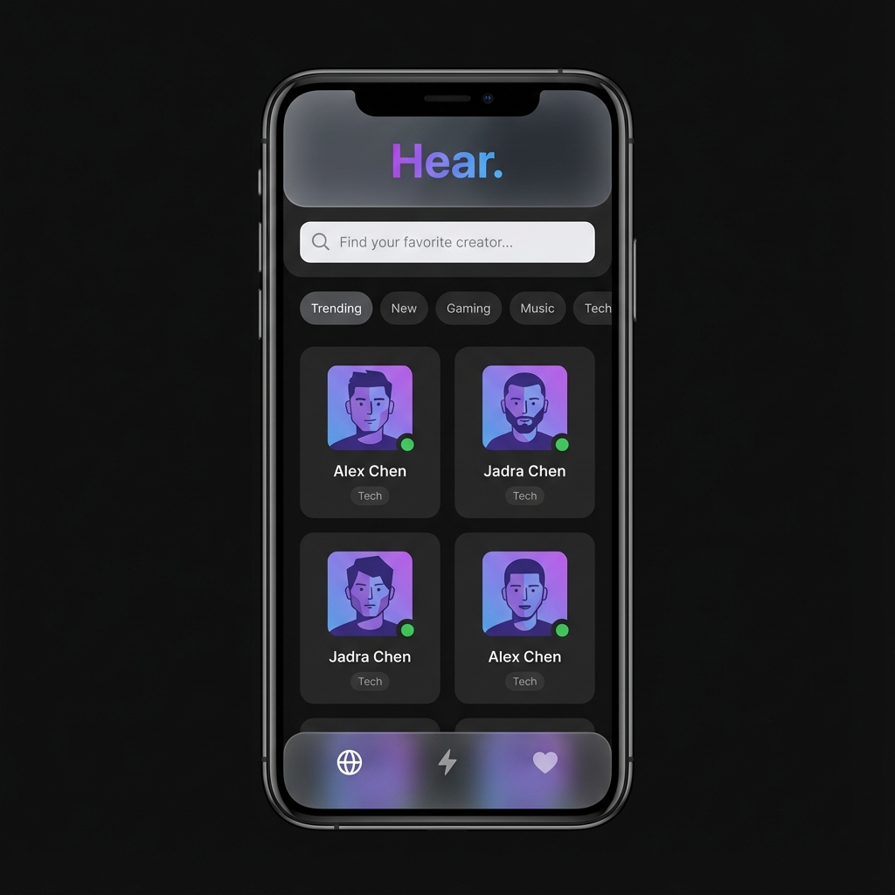
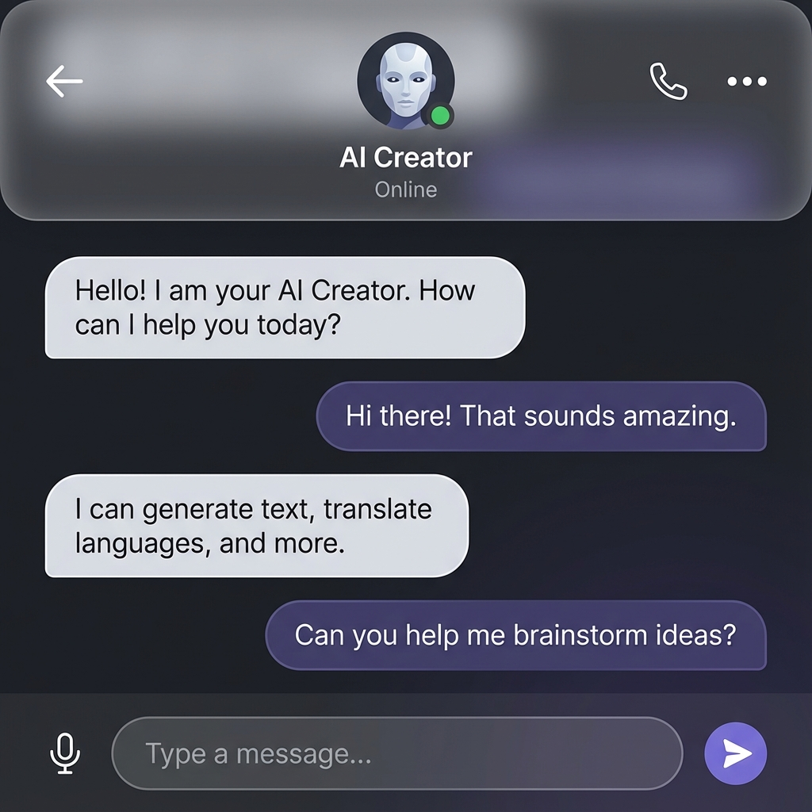

# End-User App Expansion Summary

**Date**: December 11, 2025  
**Component**: `apps/app` (Consumer-Facing PWA)

## What Was Built

Successfully architected and scaffolded the **End-User App**, a mobile-first Progressive Web App that enables fans to discover and interact with AI creator clones.

### Project Structure

```
apps/app/
├── src/
│   ├── app/
│   │   ├── page.tsx              # Home/Discovery page
│   │   ├── login/page.tsx        # Authentication
│   │   ├── c/[slug]/page.tsx     # Creator profile
│   │   └── chat/[creatorId]/     # Chat interface
│   ├── components/ui/            # Reusable components
│   │   ├── button.tsx
│   │   ├── input.tsx
│   │   └── card.tsx
│   └── lib/
│       └── utils.ts              # Utilities
```

### Core Features Implemented

#### 1. Home/Discovery Page (`/`)
- Search bar with icon
- Category filters (Trending, New, Gaming, Music, Tech)
- Featured creators grid (2-column layout)
- Recent chat history
- Bottom navigation bar



#### 2. Authentication (`/login`)
- Google OAuth sign-in button
- Facebook OAuth sign-in button
- Reference code entry
- Premium glassmorphic design

#### 3. Creator Profile (`/c/[slug]`)
- Hero cover image
- Creator stats (followers, rating, messages)
- Follow button
- Chat and Call action buttons
- Share functionality
- Deep linking support (QR codes, referral codes)

#### 4. Chat Interface (`/chat/[creatorId]`)
Three interaction modes:
- **Text Chat**: Traditional message bubbles
- **Voice Tier 1** (UI): Mic button for push-to-talk
- **Voice Tier 2** (UI): Full-screen call overlay



### Technical Highlights

**Framework**: Next.js 16 with App Router  
**Styling**: Tailwind CSS v4 + custom design system  
**Components**: Custom UI components (shadcn/ui patterns)  
**State**: Zustand (planned for voice call states)  
**Build**: ✅ Verified successful (`pnpm build`)

### Design Philosophy

- **Mobile-First**: Touch-optimized, vertical layout
- **Premium Aesthetics**: Glassmorphism, smooth animations, modern gradients
- **Dark Mode**: OKLCH color system with proper theming
- **Fast**: Optimized routes, prefetching, minimal bundle

### Voice Chat Architecture

```
Tier 1 (Async):
User → Record → Upload → STT → LLM → TTS → Audio Bubble

Tier 2 (Duplex):
User Audio ←→ WebSocket ←→ Moshi Service ←→ Creator Audio
```

## Documentation Created

1. **`apps/app/README.md`**: App-specific documentation
2. **`docs/app_architecture.md`**: Detailed architecture, API contracts, integration patterns
3. **`docs/handover.md`**: Updated with end-user app status
4. **`TASK.md`**: Updated task list with new app items
5. **`README.md`**: Updated architecture diagram

## Integration Points

### Required APIs (Pending)

```typescript
GET  /api/personas              // List all creators
GET  /api/personas/:slug        // Creator profile
GET  /api/chat/:id/messages     // Chat history
POST /api/chat/:id/messages     // Send message
POST /api/chat/:id/voice-message // Voice Tier 1
WS   /ws/audio                  // Voice Tier 2 (duplex)
```

### Authentication Flow

Uses Supabase Auth:
- Google OAuth
- Facebook OAuth
- JWT session management

## Next Steps

### Phase 1: Backend Integration
- [ ] Implement `/api/personas` endpoint
- [ ] Set up Supabase Auth
- [ ] Create chat APIs
- [ ] WebSocket for real-time messages

### Phase 2: Voice Features
- [ ] Audio recording & upload (Tier 1)
- [ ] Higgs Audio V2 integration
- [ ] WebSocket audio streaming (Tier 2)
- [ ] Moshi service connection

### Phase 3: Polish
- [ ] Search functionality
- [ ] Filters and sorting
- [ ] Analytics tracking
- [ ] PWA setup (service worker, manifest)

## Files Modified/Created

**New Files**:
- `apps/app/*` (entire app)
- `docs/app_architecture.md`
- `docs/app_home_mockup.png`
- `docs/app_chat_mockup.png`

**Updated Files**:
- `README.md` (architecture diagram)
- `TASK.md` (task list)
- `docs/handover.md` (status update)

## Build Status

✅ **Successful Build**  
```bash
pnpm build --filter app
# ✓ Compiled successfully
# ✓ 5 routes generated
```

## Summary

The End-User App scaffold is **complete and ready for backend integration**. All core UI/UX flows are implemented with a mobile-first, premium design. The architecture supports text and voice interactions across two tiers, with clear patterns for production scaling.

**Status**: Ready for Phase 1 (API Integration)  
**Quality**: Production-ready UI, pending data layer  
**Documentation**: Comprehensive
