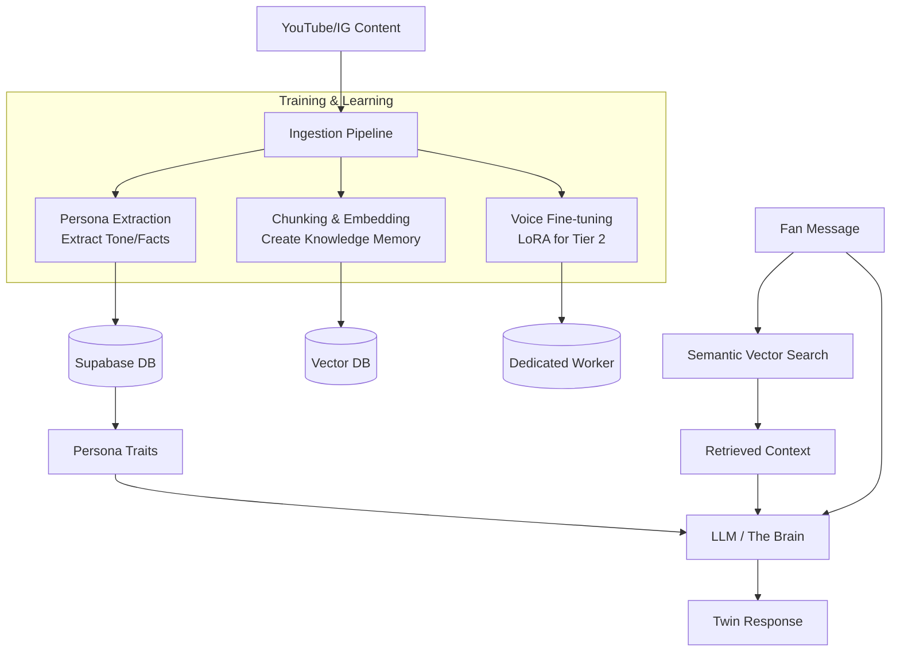

## 1. The Fact-Led Persona (The "Truth")
**Method**: **Fact Distillation & Creator Governance**  
**Model**: `Qwen-2.5-72B` / `DeepSeek-V3`

The twin's personality and knowledge are anchored by a list of **Distilled Facts**, not raw data. This is the core "operating system" for the twin.

### A. The Ingestion Hierarchy (Raw to Fact)
Raw data from any source is treated only as a "source of truth" to be synthesized into facts:
1. **Raw Sources**: YouTube Transcripts, Instagram Captions, Bio Inputs, PDF Ingestion, Perplexity Search Results.
2. **Distillation**: An LLM background process (The "Historian") extracts individual statements of fact from these sources.
3. **Consolidation**: The Historian merges identical facts, identifies contradictions, and updates old facts with newer data while preserving creator overrides.

### B. Creator Governance (The Manual Layer)
The twin ONLY uses facts that have been vetted by the creator in the **Facts Dashboard**:
- **ALLOWED (Default)**: New facts discovered during ingestion are provisionally allowed.
- **FORBIDDEN**: The creator can explicitly tell the twin never to mention or "believe" a specific fact.
- **EDITED**: The creator can rewrite any fact to correct the AI. Manual edits have the highest priority and are never overwritten by future ingestions.
- **MANUAL**: The creator can add facts directly that the AI couldn't find in the raw data.

### C. The Grounded Persona
During chat, these **Approved Facts** are injected as the highest-priority grounding. If a video says "X" but the creator's Fact says "Y", the twin will follow the Fact.

## 2. The Memory Stream (Long-Term Memory)
**Method**: **Recency-Importance-Relevance (RIR) Weighting**  
**Models**: `text-embedding-3-small` + `Qwen/DeepSeek` (Scoring & Synthesis)

For a world-class digital twin, we move from "Last 10 messages" to an **indefinite Memory Stream**. Every interaction is stored as a "Memory" and assigned a score during the chat loop.

### A. The Three Pillars of Memory Value
We calculate the "Retrieval Score" for every memory chunk using:
1. **Recency**: Newer memories are weighted higher to maintain current context flow.
2. **Importance (Significance)**: When a memory is created, an LLM background task assigns an importance score (1-10). A fan mentioning their dog is a 3; a fan sharing a personal struggle or a milestone is a 9.
3. **Relevance (Semantic Similarity)**: How well the memory matches the *current* query.

### B. Lossless Retrieval Flow
1. **Store**: Every message is archived and embedded.
2. **Score**: Every N messages, an LLM evaluates the significance of the block.
3. **Retrieve**: When responding, the system queries the vector DB for the top chunks but sorts them by the **RIR Score** (Recency × Importance × Relevance).
4. **Synthesis**: The twin receives $K$ fragments of high-weight history (both old significant ones and new relevant ones) to form its answer.

### C. The "Trigger" Effect (Precision Retrieval)
Semantic Relevance acts as a **High-Priority Trigger**. Even if a memory is 2 years old and scored low on "daily importance":
1. **Match**: If the fan explicitly mentions a detail (e.g., "The red scarf you wore in London"), the Relevance score spikes.
2. **Context Restoration**: The system doesn't just pull one chunk; it pulls the **entire conversation block** surrounding that match.
3. **Detail Picking**: This restores the "working memory" of that specific past event, allowing the twin to pick up Every detail as if it happened yesterday.

Data is never "lost"; it is simply "dormant" until the fan or creator provides the semantic key to unlock it.

## 3. The Voice Twin (The "Voice")
**Method**: **Zero-Shot (Tier 1)** vs. **Fine-tuning (Tier 2)**

- **Tier 1 (Higgs V2)**: **Zero-shot cloning**. The model uses a 30-second "Prompt" of your voice to mimic you instantly. No training happens here; it's like a high-tech filter.
- **Tier 2 (GLM-4-Voice)**: **Actual Training (LoRA)**. For the highest quality, we take your cleaned audio and perform **Parameter-Efficient Fine-Tuning (LoRA)** on the GLM-4-Voice model. This *actually* changes the weights of the model to match your vocal nuances.

## End-to-End Visual Flow

## Summary of Models Used
| Purpose | Model |
| :--- | :--- |
| **Reasoning & Chat** | Qwen-2.5 / DeepSeek |
| **Vision (IG Images)** | Gemini 2.0 Flash |
| **Search (Embeddings)** | text-embedding-3-small |
| **Voice (Tier 1)** | Higgs Audio V2 |
| **Voice (Tier 2)** | GLM-4-Voice (LoRA) |
