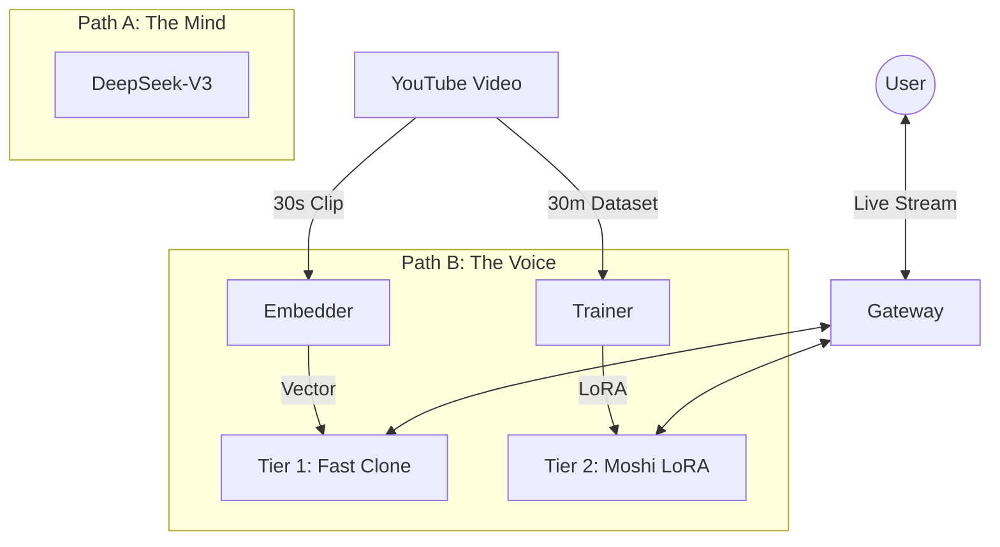

# Production & Scaling Strategy

## 1. Scaling the AI (Moshi)
Moving from a single "Private Cloud" GPU to a production fleet requires a shift in infrastructure.

### Phase 1: The "Garage" (Current)
*   **Infrastructure**: Single RTX 4070 Super (Home LAN).
*   **Capacity**: ~1-2 concurrent conversations.
*   **Cost**: $0 (CapEx only).
*   **Bottleneck**: If 3 people call at once, the 3rd person gets a busy signal or massive lag.

### Phase 2: Cloud GPUs (Growth)
*   **Infrastructure**: Managed GPU Providers (RunPod, Lambda Labs, or Massed Compute).
*   **Hardware Target**: A100 (80GB) or H100. One A100 can run multiple 8-bit instances of Moshi via vLLM or similar batching techniques (if supported) or simply partition the GPU.
*   **Orchestration**:
    *   Spin up docker containers on demand.
    *   Load Balancer distributes WebSocket connections to available GPU nodes.
*   **Cost**: ~$0.50 - $2.00 per hour per GPU.

### Phase 3: Serverless / Inference-as-a-Service (Scale)
*   **Infrastructure**: Platforms like **Modal** or **Replicate**.
*   **Concept**: You don't manage boxes. You send a WebSocket request, they spawn a micro-VM.
*   **Pros**: Infinite scaling.
*   **Cons**: Cold starts (latency) can be high for real-time audio. You usually need "warm" instances, making it similar to Phase 2.

---

## 2. The "Brain & Mouth" Architecture (Revised for High Fidelity)

To capture the **Soul** (Facts) and the **Vibe** (Stutters, pauses, laugh style), we need a **Dual-Path Learning** system. We cannot rely on context windows alone.

### Component A: The "Fact Extractor" (DeepSeek/Qwen)
*   **Role**: Extracts Memories, Beliefs, and Knowledge.
*   **Why Chinese Models?**: Models like **DeepSeek-V3** or **Qwen-2.5** offer SOTA reasoning at a fraction of OpenAI's cost.
*   **Process**:
    1.  Ingest YouTube Transcript.
    2.  Agent (DeepSeek) extracts "Core Memories" and "Topics".
    3.  Output: A structured Knowledge Graph (Vector DB).

### Component B: The "Mouth" (Tiered Voice Architecture)
The user research confirms we can achieve "ElevenLabs-style" onboarding without expensive training for everyone.

#### Tier 1: Instant Cloning (The Default)
*   **Tech**: Token-based TTS with Reference Embeddings (**Higgs Audio V2**).
*   **Process**:
    1.  Creator uploads 30s of clean audio.
    2.  We extract a `style_embedding` vector (negligible compute).
    3.  **Runtime**: Pass `style_embedding` + Text to the model.
*   **Result**: 85% fidelity. Captures timbre and basic emotion. fast and cheap.

#### Tier 2: High-Fidelity LoRA (Premium / Super-Creator)
*   **Tech**: **Moshi Fine-Tuning** (Proprietary/Community tools).
*   **Process**:
    1.  Creator provides 30+ mins of audio.
    2.  We run a GPU training job to create a **LoRA Adapter**.
*   **Result**: 99% fidelity. Captures subtle laughs, specific stutter patterns, and deep prosody.

### Phase C: The "Performance" (Realtime)
1.  **User Speaks**.
2.  **Speech Model**:
    *   *Standard*: Uses `style_embedding` (Zero-shot).
    *   *Premium*: Loads `creator_lora` (Fine-tuned).
3.  **Brain**: DeepSeek-V3 injections facts.
4.  **Mouth**: Generates audio.

### Diagram: The Hybrid Forge

